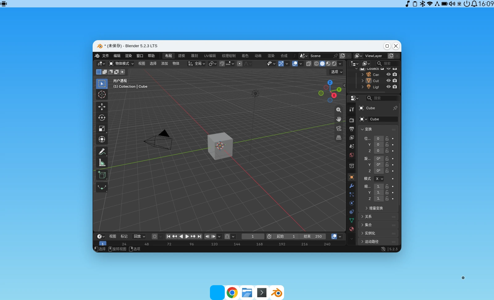
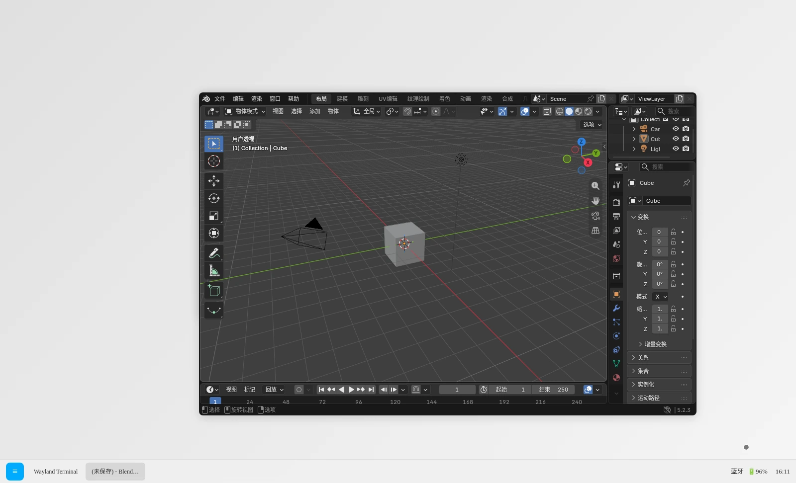

# myde

[中文](./README.md)

A Linux Wayland desktop environment (compositor) built on Electron. It parses Wayland protocols in JavaScript and renders native applications (such as Firefox) to a Canvas, instead of relying on custom Web software.

> **Status**: In development; only some applications are supported.

## Vision

Window management, decorations, desktop widgets, taskbar and more can all be customized freely by developers.

Design unconventional interfaces, recreate the Windows/macOS look, or even adapt layouts for phones and tablets — bring frontend ideas to life quickly.

Developers don't need to deal with low-level display protocols or manage memory manually; in an environment more convenient than C/Rust, we hope to grow a more usable and more capable Linux desktop.

**MAKE LINUX DESKTOP GREAT AGAIN!**

## Current Progress

Displays Wayland applications with normal rendering and interaction; supports direct output to the screen and reads input from keyboards, mice, touchpads and more. Some APIs are implemented, including Wi-Fi, Bluetooth, power, notifications, laptop lid, and IME. The official desktop is also implemented as a permanent demo and a north star, ready to use out of the box.

There are still display and interaction issues in some applications, and the custom desktop API is not yet stable — treat this as a **tech demo**. The project is in **Beta** and is now my daily desktop environment; it will move to a stable stage once KDE is no longer needed as a fallback. For more limitations, see [Limitations](#limitations).

**Official desktop (with Blender)**



**Example demo desktop (with Blender)**



## Running

### Requirements

- Linux with systemd, dbus and other base services
- `xwayland-satellite` installed (the official desktop starts it automatically)
- x86_64 and arm64 supported (releases provide packages for both; native dependencies pick the matching prebuilt module)

### Install Dependencies

(`pnpm` can be replaced with `npm` if preferred)

```shell
pnpm i
```

### Start the Desktop (in a window)

Start the default desktop:

```shell
pnpm run desktop:official
```

Alternatively, download the tar.gz from releases and start `myde`.

Start the simple Windows-style demo desktop:

```shell
pnpm run desktop:example
```

A window will open where you can launch installed applications.

### Running on the Host

To output directly to the screen instead of running in a window, download a release package and run `./myde-wrap myde`.

We recommend starting from a TTY: switch to a new TTY with `Ctrl+Alt+F3` and run the command there. Some desktops (such as KDE) let you run myde in another TTY and switch back to the original desktop afterwards, so keep at least one familiar desktop as a fallback and try the official myde desktop first. Press `Super+Shift+E` or `Ctrl+Alt+Delete` to quit.

### Logs

Logs are written to `$XDG_STATE_HOME/myde/logs` (default `~/.local/state/myde/logs`):

- `myde.log`: main process log, including renderer `console` output and crash/unresponsive events; rotated to `myde.log.1` etc. after 10 MiB, keeping 3 files.
- `apps/<executable>-<pid>.log`: stdout/stderr of apps launched by the desktop, timestamped with `[out]`/`[err]` markers; the 50 most recent are kept.

In native mode (fullscreen `myde-wrap`), stdout lands on the DRM-occupied TTY and is invisible on screen, so the log files are the main debugging entry point. Application output must be read; otherwise the app blocks in `write()` once 64 KiB fills up, which shows as a frozen window while the desktop stays responsive.

## Development

See [AGENTS.md](./AGENTS.md) for development details; it is aimed at developers and LLM tools.

myde is not only a Web desktop — it also lets other desktop implementations plug in.

### Custom Desktop Development

- The default desktop implementation lives in `desktop/` for reference.
- Provides window management API, unified settings/interconnect API, and many system APIs (MPRIS media control, notifications, battery, Bluetooth, Wi-Fi, etc.). See [Wayland Protocol Support](./src/wayland/readme.md) and [Desktop API Documentation](./desktop/readme.md) for progress and the supported protocol list.

> **License Note**: Although this project is AGPL-3, custom desktop plugins are theoretically not infected. For user safety and community prosperity, we recommend open source for community review; while keeping personal copyright, you may use a slightly stricter license.

## Architecture

myde is built on Node.js and the Electron framework, using Node.js native modules and system-level components (e.g. Wayland client, dbus) for inter-process communication via Unix sockets. All Wayland protocol messages are parsed and processed by JavaScript, reading or mapping graphics resources, and finally rendering via Canvas in Electron's renderer process (i.e. the web page).

### Where Native Code Is Used

- `myde-wrap`: a host compositor written in Rust, for desktopless environments where Electron cannot output directly
- Node.js libraries such as `fs`
- Electron APIs such as `sharedTexture`
- Unix socket library (Node.js's built-in socket library does not support fd transfer)
- PAM module
- `myde-input`: non-blocking input reading
- `myde-drm`: reads DRM formats Electron does not support and converts SHM formats (RGB ordering, avoiding per-pixel conversion in JS)

## Limitations

- Because Electron cannot output directly to a native display, myde currently relies on `myde-wrap` to provide a simple Wayland display host.
- Electron and Web rendering still have limits; some paths require more complex rendering, adding performance overhead.
- Many protocols are supported, but implementations still deviate in places; details need refinement.

## Links

[Linux.do](https://linux.do)
