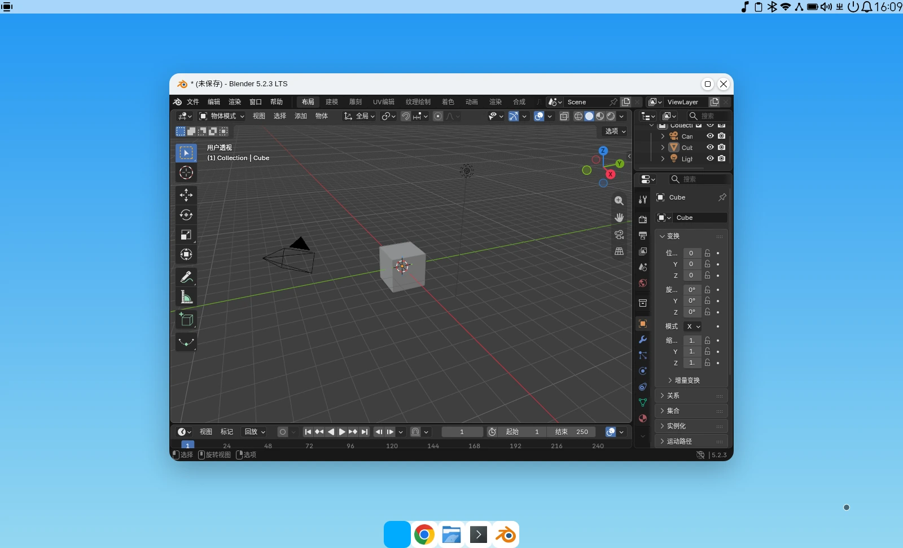
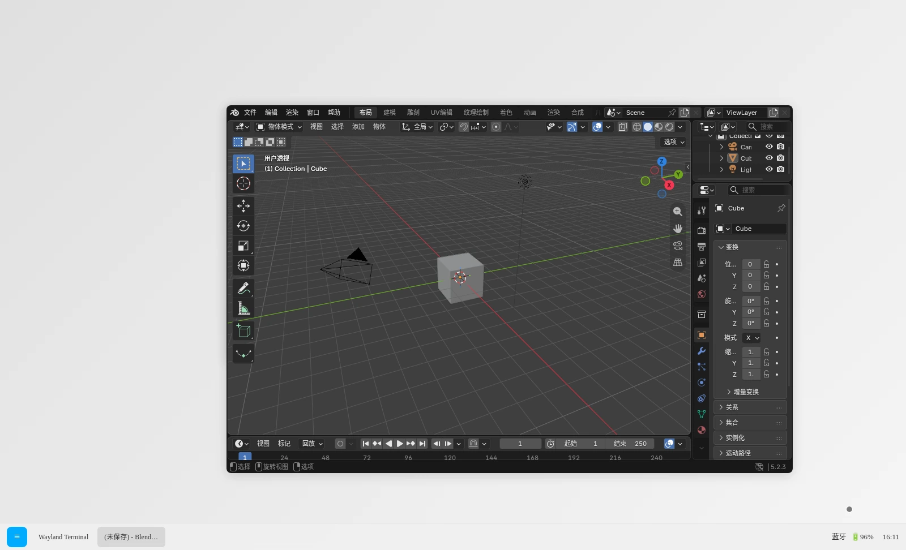

# myde

[English](./README.en.md)

基于 Electron 构建的 Linux Wayland 桌面环境（合成器）。它通过 JavaScript 解析 Wayland 协议，将原生应用（如 Firefox）渲染至 Canvas，而非依赖 Web 定制软件。

> **当前状态**：开发中，仅支持部分应用。

## 项目愿景

窗口管理、装饰、桌面组件、任务栏等，均可由开发者自由定制。

设计前卫的交互界面，复刻 Windows/macOS 风格，甚至适配手机或平板布局，把前端想法快速实现。

开发者无需处理底层显示协议，无需手动管理内存，在相比 C/Rust 更便利的开发环境下，希望孵化出更易用、功能更强的 Linux 桌面。

**MAKE LINUX DESKTOP GREAT AGAIN!**

## 当前进展

可显示 Wayland 应用并正常渲染、交互；支持直接输出到屏幕，并读取键盘、鼠标、触控板等输入。Wi-Fi、蓝牙、电源、通知、笔记本合盖、IME 等部分 API 已实现；官方桌面也已实现，作为常驻演示和风向标，开箱即用。

目前应用仍有显示或交互问题，自定义桌面 API 尚不稳定，请将其视为 **技术演示**。项目处于 **Beta** 阶段，已成为我的日常桌面环境；待不再需要 KDE 作为后备时，将转入稳定阶段。更多局限请参考[局限](#局限)章节。

**官方桌面（运行 Blender）**



**example 演示桌面（运行 Blender）**



## 运行指南

### 环境要求

- Linux 系统（需要 systemd、dbus 等基础服务）
- 需安装 `xwayland-satellite`（官方桌面启动时会自动拉起它）
- 支持 x86_64 与 arm64（release 提供对应架构的安装包；原生依赖会按架构自动选择预编译模块）

### 安装依赖

（`pnpm` 可替换为 `npm`，依个人偏好）

```shell
pnpm i
```

### 启动桌面（作为子窗口显示）

启动默认桌面：

```shell
pnpm run desktop:official
```

也可以从 release 下载 tar.gz 安装包，解压后启动 `myde`。

启动简易 Windows 风格演示桌面：

```shell
pnpm run desktop:example
```

执行后将会弹出窗口，你可以在其中启动系统已安装的应用程序。

### 运行在主机上

如果不想以窗口模式运行，而是直接输出到屏幕，可以下载 release 安装包，解压后执行 `./myde-wrap myde`。

建议在 TTY 中启动：按 `Ctrl+Alt+F3` 等快捷键切换到新的 TTY，再执行上面的命令。有些桌面（如 KDE）允许你在另一个 TTY 运行 myde，并且之后还能切回原桌面；因此建议至少保留一个常用桌面作为后备，先拿 myde 官方桌面尝鲜。按 `Super+Shift+E` 或 `Ctrl+Alt+Delete` 退出。

### 日志

日志写在 `$XDG_STATE_HOME/myde/logs`（默认 `~/.local/state/myde/logs`）：

- `myde.log`：主进程日志，包含渲染进程 `console` 与崩溃、无响应事件；超过 10 MiB 轮转为 `myde.log.1` 等，保留 3 份。
- `apps/<可执行名>-<pid>.log`：桌面启动的应用 stdout/stderr，带时间和 `[out]`/`[err]` 标记；最多保留最近 50 份。

原生模式（`myde-wrap` 全屏）下 stdout 落在被 DRM 占用的 TTY 上，屏幕上看不到，日志文件是主要排查入口。应用输出必须被读取，否则写满 64 KiB 后应用会阻塞在 `write()`，表现为窗口画面卡死而桌面仍然流畅。

## 开发指南

开发细节请参阅 [AGENTS.md](./AGENTS.md)，该文档面向开发者和 LLM 工具。

myde 的特色不仅是 Web 桌面，还允许其他桌面实现接入。

### 自定义桌面开发

- 默认桌面实现位于 `desktop/` 文件夹，可供参考。
- 提供窗口管理 API、统一设置/互联 API，以及众多系统 API（如 MPRIS 媒体控制、通知、电量、蓝牙、Wi-Fi 等）。详细进度和支持列表请参考 [Wayland 协议支持列表](./src/wayland/readme.md)和[桌面 API 文档](./desktop/readme.md)。

> **许可说明**：尽管本项目采用 AGPL-3 协议，但自定义桌面插件理论上不受传染。出于用户安全和社区繁荣考虑，建议开源以方便社区审查；同时，若保留个人版权，可采用稍严格的许可证。

## 实现原理

myde 基于 Node.js 与 Electron 框架，利用 Node.js 原生模块与系统底层组件（如 Wayland 客户端、dbus）通过 Unix Socket 进行进程间通信。所有 Wayland 协议消息经由 JavaScript 解析和处理，读取或者映射图形资源，最终通过 Electron 的渲染进程（即 Web 页面）中的 Canvas 完成图形绘制。

### 使用了原生编程的地方

- `myde-wrap`：用 Rust 实现的宿主合成器，用于 Electron 目前无法直接显示的无桌面环境
- Node.js 相关库，如 `fs`
- Electron 相关 API，如 `sharedTexture`
- Unix socket 库（Node.js 自带的 socket 库不支持 fd 传输）
- PAM 模块
- `myde-input`：无阻塞读取输入
- `myde-drm`：读取 Electron 不支持的 DRM 格式，并做 SHM 格式转换（RGB 顺序调整，避免在 JS 中逐像素转换）

## 局限

- 由于 Electron 无法直接输出到原生显示，目前依赖 `myde-wrap` 提供一个简单的 Wayland 显示宿主。
- Electron 与 Web 的渲染能力仍有限制，部分场景需要走更复杂的渲染路径，带来额外性能开销。
- 许多协议虽支持，但具体实现仍有偏差，细节待完善。

## 友链

[Linux.do](https://linux.do)
